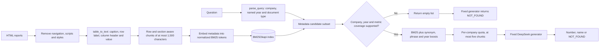

# FTEC5660 Homework 4

This repository contains the implementation for the retrieval side of the Homework 4 RAG
assistant.

## Setup

```powershell
python -m venv .venv
.\.venv\Scripts\Activate.ps1
pip install -r requirements.txt
```

Create a local `.env` file with:

```text
DEEPSEEK_API_KEY=your_key_here
```

The file is ignored by Git. Do not commit the key.

## Run

```powershell
python hw4.py --data-folder public_test
```

The runner writes `results.csv` and reports the score for Tasks 1 to 4 on the public set.

To reproduce the Task 5 retrieval ablation without calling the answer generator:

```powershell
python task5_ablation.py
```

This writes the summary to `task5_ablation.csv` and the per-question results to
`task5_ablation_details.csv`.

## Homework 4 solution

### 1. Pipeline overview

The implementation uses a deterministic document-processing path and a lexical query path, which
meet at a metadata-constrained BM25 index. It does not use embeddings or an LLM during parsing,
chunking or retrieval.



For every document, `chunk_document()` strips irrelevant HTML, detects the company, fiscal year and
document type, converts each table into lines that retain the caption and row/column/value relations,
and stores narrative or table-row chunks with the required metadata plus section and table context.
`build_index()` normalizes case, punctuation, simple plurals and common finance synonyms before
constructing a `BM25Okapi` index. At query time, `parse_query()` identifies the requested companies,
named year and document type. Retrieval restricts the candidate set to the corresponding metadata
subset, rejects unsupported companies/years and missing query concepts, then ranks within that subset
with BM25 and concept-phrase/year boosts. Comparison questions reserve slots for every company. All
these choices reject an unsupported question before generation rather than trying to repair a bad
answer afterwards.

Local public-test checks without invoking the answer generator:

| Component | Result |
| --- | ---: |
| Task 1.1 table cells retained | 100.0% |
| Task 1.2 documents passing metadata/content checks | 100.0% |
| Task 2.2 query fields correct | 100.0% |
| Task 2.3 Recall@5 on answerable questions | 100.0% |
| Answerable questions returning chunks | 100.0% |
| Unanswerable questions rejected | 100.0% |

### 2. Ablation protocol

The experiment follows the handout's definition of a naive B0 and changes one component in each
successive row. All rows use the same 40 public documents and 60 questions. The table reports
Recall@5 over the 46 answerable questions, the share of answerable questions that keep at least one
chunk ("kept"), the share of the 14 unanswerable questions rejected with `[]`, and the Task 3 score
`max(0, kept + rejected - 1)`. Parse accuracy and category recall are also included to make the
failure path visible. The retrieval experiment does not call the generator; V7 is the configuration
in the submitted `retrieve()`, whose existing `results.csv` has 100% end-to-end answer accuracy.

| Variant | One change relative to the row above | Chunks | Parse | Recall@5 | Kept | Rejected | Task 3 | Fact | Table | Comparison |
| --- | --- | ---: | ---: | ---: | ---: | ---: | ---: | ---: | ---: | ---: |
| B0 | Naive RAG: BeautifulSoup text, recursive split, whitespace BM25 over all chunks, no parsing, never `[]` | 210 | N/A | 41.3% | 100.0% | 0.0% | 0.0% | 75.0% | 31.8% | 25.0% |
| V1 | Preserve each table with `table_to_text()` | 240 | N/A | 37.0% | 100.0% | 0.0% | 0.0% | 83.3% | 22.7% | 16.7% |
| V2 | Use section/row-aware chunks with contextual headers | 3,478 | N/A | 19.6% | 100.0% | 0.0% | 0.0% | 50.0% | 13.6% | 0.0% |
| V3 | Add `parse_query()` and company/year/document-type filtering | 3,478 | 100.0% | 47.8% | 100.0% | 0.0% | 0.0% | 91.7% | 50.0% | 0.0% |
| V4 | Add normalized tokenization and synonym expansion | 3,478 | 100.0% | 89.1% | 100.0% | 0.0% | 0.0% | 100.0% | 100.0% | 58.3% |
| V5 | Add concept-phrase and named-year score boosts | 3,478 | 100.0% | 93.5% | 100.0% | 0.0% | 0.0% | 100.0% | 100.0% | 75.0% |
| V6 | Add a per-company quota to comparison retrieval | 3,478 | 100.0% | 100.0% | 100.0% | 0.0% | 0.0% | 100.0% | 100.0% | 100.0% |
| V7 | Add abstention guards for unknown company/year or missing metric; this is the final code | 3,478 | 100.0% | 100.0% | 100.0% | 100.0% | 100.0% | 100.0% | 100.0% | 100.0% |

`N/A` means that the corresponding variant does not call `parse_query()`. The raw, per-question
results and exact miss lists are in `task5_ablation_details.csv`; the summary is in
`task5_ablation.csv`.

### 3. Analysis of each change

**B0 - naive baseline.** Raw HTML text retains values but merges adjacent table cells and loses the
link between a number, its row label and its column header. The 210 large chunks also mix several
document sections, and whitespace tokens such as `revenue,` do not match normalized query tokens.
Table recall is only 31.8% and overall Recall@5 is 41.3%.

**V1 - table-to-text preservation.** This change alone reduced Recall@5 from 41.3% to 37.0%. It
improved fact recall from 75.0% to 83.3%, but table recall fell from 31.8% to 22.7%. Repeating the
column header on every row increases common-token frequency, while the unchanged recursive splitter
and punctuation-sensitive whitespace BM25 do not exploit the new structure. This is a negative
interaction, not evidence that table preservation is useless; the interaction disappears once the
index and chunking are improved.

**V2 - structured chunks.** One table row or paragraph per chunk makes the evidence more local, but
it also grows the index from 240 to 3,478 chunks. With no query parsing and the same whitespace
tokenizer, too many small chunks compete on generic words such as `revenue` or `income`; Recall@5
falls to 19.6%. The result shows that chunk granularity is useful only when retrieval also uses
metadata and normalized lexical matching.

**V3 - query parsing and metadata filtering.** Parsing the company, named year and document type
raises Recall@5 from 19.6% to 47.8% and fact/table recall to 91.7%/50.0%. It also prevents the
wrong-year and wrong-report candidates that raw BM25 cannot distinguish. Comparison recall is still
0% because the single global top-5 list is often dominated by one company.

**V4 - normalized tokenization and synonym expansion.** Canonicalizing plurals/punctuation and
expanding terms such as `employees`/`headcount` and `auditor`/`audit` is the largest single gain:
Recall@5 rises from 47.8% to 89.1%. Fact and table recall both reach 100%, while comparison recall is
only 58.3%; five comparison questions still have evidence for only one company.

**V5 - phrase and year boosts.** Concept phrases such as `cash and cash equivalents` receive a score
bonus, and chunks containing the named year receive a smaller bonus. Recall@5 increases to 93.5% by
fixing two comparison questions. It leaves `q023`, `q053` and `q056`, showing that score boosting
cannot guarantee coverage of both companies when all slots are allocated globally.

**V6 - per-company quota.** Reserving slots separately for each comparison company fixes those last
three comparison questions and raises comparison recall from 75.0% to 100%. Overall kept is still
100%, so this change does not trade away answerable coverage.

**V7 - abstention.** The reject rate moves from 0.0% to 100.0% without reducing answerable kept or
Recall@5. The final Task 3 score becomes 100.0%, and `results.csv` records 60/60 correct end-to-end
answers. This component matters because the baseline always returns five plausible chunks even for a
company that does not exist or a year/metric that is not disclosed.

### 4. Error analysis

The final public-test run has no end-to-end errors: all 46 answerable questions return evidence and
all 14 unanswerable questions are rejected. The ablation exposes three failure modes that the final
guards address:

1. **Dense, table-like text without metadata.** B0 misses 27 of 46 answerable questions, including
   15 of 22 table questions and 9 of 12 comparison questions. The retriever sees the right vocabulary
   but often cannot separate the right table row, company or year.
2. **Fine chunks without normalized lexical matching.** V2 misses 37 answerable questions. The 3,478
   chunks contain the evidence, but punctuation, morphological variants and generic financial terms
   prevent the correct row from entering top-5.
3. **One-sided comparison context.** After query filtering and normalization, V4 fails exactly
   `q013`, `q022`, `q023`, `q053` and `q056`; V5 reduces this to `q023`, `q053` and `q056`. Every
   listed miss is a comparison question, so the remaining problem is slot allocation rather than
   corpus recall.

These results also indicate risks that the public score alone cannot rule out. A company alias with
no exact vocabulary match can be mistaken for an absent company; a metric may have a different label
while still appearing in the annual report; and a table can contain both consolidated and segment
figures. The deterministic year/company gate intentionally favours rejection over a confidently
wrong answer, while the section/table header helps the fixed generator choose the correct row and
column when several candidates are present.

### 5. Takeaway

The strongest improvement comes from making the representation and the retrieval objective agree:
metadata filtering removes impossible candidates, normalized BM25 finds the table terminology, and
per-company retrieval protects comparison evidence. Abstention then removes false-positive contexts.
The pipeline is therefore not merely a stronger lexical ranker; it is a sequence of independent
constraints that each addresses a specific observed failure mode.

## Task 6: Reflection

[Read the Task 6 reflection PDF](output/pdf/Task6_Reflection_LIU_YIBO.pdf).
